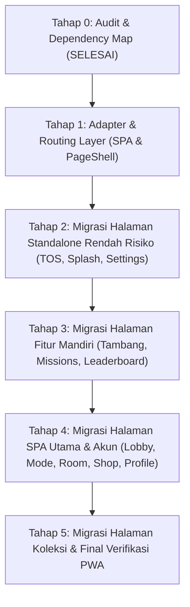

# DRAGON ROLL — LAPORAN AUDIT ARSITEKTUR TAHAP 0
## Pemetaan Dependensi & Perencanaan Restrukturisasi Folder (Vue-Like Architecture)

**Repository:** `rohmanaa/dragonroll`  
**Branch Kerja:** `feat/design-tokens-stage2`  
**Baseline Commit:** `722d14b9a6ebb218441d580637b6b957b0ea8747`  
**Service Worker Aktif:** `ut-pwa-v607`  
**Tanggal Audit:** 28 November 2026  
**Status Tahap 0:** Selesai (Audit Menyeluruh — Tanpa Perpindahan File & Tanpa Perubahan Kode)

---

## 1. Eksekutif Ringkasan & Batasan Mutlak

Audit ini merupakan fondasi **Tahap 0** sebelum memulai restrukturisasi tata letak file proyek Dragon Roll ke dalam pendekatan **Feature-Based / Vue-Like Folder Structure**.

### 1.1 Prinsip Desain Arsitektur
- **Bukan Penggantian Framework:** Proyek tetap menggunakan vanilla web technologies (HTML5, CSS3, Vanilla JavaScript, WebGL/Three.js, Supabase, Service Worker PWA). Tidak ada migrasi ke Vue.js, React, Vite, atau build-tool bundler eksternal.
- **Pola Pengorganisasian:** Mengadopsi pola folder berbasis fitur (feature-colocated) di mana file HTML, CSS, dan JavaScript yang melayani satu halaman/fitur berada dalam satu direktori yang berdekatan.
- **Integritas Runtime:** Seluruh sistem SPA (`spa-host.js`), injeksi komponen bersama (`page-shell.js`), registri item (`item-registry.js`, `item-catalog.js`), engine 3D gameplay, dan service worker cache-first dipertahankan fungsionalitasnya 100%.

### 1.2 Batasan Mutlak Tahap 0
1. **Zero Code Changes:** Tidak ada file yang dipindahkan, diubah namanya, atau dihapus pada Tahap 0.
2. **Zero Functional Drift:** Logika gameplay, aturan main, database Supabase, dan desain visual tidak disentuh.
3. **Branch Purity:** Semua pekerjaan dilakukan di branch `feat/design-tokens-stage2`. Branch `main` tidak disentuh langsung.

---

## 2. Struktur Eksisting Saat Ini (Current State Analysis)

Dragon Roll saat ini menggunakan arsitektur modular multi-layer dengan pemisahan direktori horizontal berdasarkan tipe file:

```text
dragonroll/ (root)
├── *.html                               # 24 file HTML utama (Lobby, Gameplay, Room, Shop, dll.)
├── assets/
│   ├── css/                             # 27 file CSS global dan page-level
│   │   ├── base/                        # reset.css
│   │   ├── utilities/                   # common.css, loading.css
│   │   ├── components/                  # overlay.css, skeleton.css, game-dialog.css, chest-reveal.css
│   │   └── pages/                       # 12 file CSS override halaman (lobby.css, room.css, dll.)
│   ├── js/
│   │   ├── core/                        # 16 file sistem inti (spa-host, page-shell, app, session, dll.)
│   │   ├── pages/                       # 15 file script halaman (mode.js, settings.js, leaderboard.js, dll.)
│   │   ├── services/                    # 6 service (appearance, wallet, hearts, mail, tos, ads)
│   │   ├── systems/                     # 5 sistem (skeleton, game-dialog, update-service, graphics-auto)
│   │   ├── renderers/                   # Render 3D/2D (dice-kit/, power-3d/, item-art.js, blocky-character.js)
│   │   └── vendor/                      # three.r170.module.min.js, three.min.js
│   └── components/                      # 22 direktori komponen UI (button, tabs, modal, card, dll.)
├── data/
│   ├── inventory/                       # Registri item (aura, character, dice, frame, pet, power)
│   ├── lobby/                           # Script khusus lobby (data/lobby/js/lobby.js)
│   └── power/                           # 3D assets & power-fx.js
├── gameplay/                            # Sub-sistem gameplay mandiri (assets/, css/, js/)
├── tambang-world/                       # Sub-sistem tambang 3D mandiri (css/, js/, fonts/, images/)
└── tests/                               # 109 test files Node.js
```

---

## 3. Audit Khusus: `gameplay.html` (The Source of Truth Gameplay)

`gameplay.html` adalah inti mekanika permainan Dragon Roll (Ular Tangga 3D). Analisis mendalam menunjukkan bahwa halaman ini beroperasi sebagai aplikasi 3D mandiri yang sangat terisolasi dari siklus hidup SPA reguler:

### 3.1 Karakteristik Runtime
- **Standalone Execution:** Tidak menggunakan `UT.PageShell.renderBase()`. Dikecualikan secara eksplisit dalam `tests/page-shell.test.js`.
- **SPA Host Iframe Isolation:** Dalam `play.html`, `gameplay.html` **tidak pernah** dirender via DOM injection `#view`, melainkan dimuat ke dalam `<iframe id="f">` untuk memastikan WebGL rendering context tidak bocor dan performa 60 FPS tetap terjaga.
- **Import Maps & Module Loading:**
  - Menggunakan native `<script type="importmap">` untuk memetakan `"three"` ke `./assets/js/vendor/three.r170.module.min.js`.
  - Memuat modul ES: `assets/js/renderers/dice-kit/index.js`, `gameplay/js/power3d-loader.js`, dan `gameplay/js/multiplayer-init.js`.

### 3.2 Struktur Sub-sistem `gameplay/`
Direktori `gameplay/` memiliki 70 file:
1. **Engine Logic (`gameplay/js/` - 35 file):**
   - `main.js`: Monolit engine 3D papan catur (539 KB, ~6.700 baris) yang mengelola siklus turn, pawn movement, board grid, kamera, ladder & snake transitions.
   - `game-core.js`, `duel-core.js`, `duel-ui.js`: Logika duel dan mini-game versus boss.
   - `dice-throw.js`, `dice-pad.js`, `dice-ui.js`: Fisika lempar dadu dan UI dadu.
   - `voxel-geom.js`, `biomes.js`, `themes.js`: Pembangun geometri voxel dan tema peta.
   - `fx.js`, `particle-fx.js`, `creeper-fx.js`, `firework-fx.js`: Sistem partikel 3D.
   - `maps/registry.js`, `maps/world.js`, `maps/nether.js`: Definisi koordinat ubin dan rute 3D.
2. **Styling (`gameplay/css/` - 13 file):**
   - `gameplay-base.css`, `gameplay.css`, `gameplay-overrides.css`, `dice-pad.css`, `hud-mockup.css`, `hud-player-card.css`, `hud-menu.css`, `duel.css`, `pause.css`, `win-screen.css`, `level-up.css`, `action-icons.css`, `particle-fx.css`.
3. **Assets (`gameplay/assets/`):**
   - `gameplay/assets/duel/`: Latar arena kristal, UI versus, banner.
   - `gameplay/assets/maps/`: Tekstur voxel (`texpack.webp`, `texpack.json`, blok rumput, cobble, daun, tanah) dan banner peta nether/world.

---

## 4. Audit Khusus: `tambang.html` & Sub-sistem `tambang-world/`

`tambang.html` adalah fitur eksplorasi dunia tambang voxel 3D yang beroperasi semi-independen.

### 4.1 Karakteristik Runtime & Dependensi
- **PageShell Integration:** Menggunakan `UT.PageShell.renderBase()`.
- **Komponen Shared:** Memuat `button.css`, `tile-button.css`, `item-icon.css`, `modal-kit.css`, `tabs.css`, `drawer.css`, `plus-button.js`, `resource-bar.js`.
- **Integrasi Server & Wallet:** Terhubung ke server via `assets/js/services/wallet-service.js`, `tambang-world/js/tambang-service.js`, dan `tambang-world/js/tambang-bridge.js`. Memanggil RPC Supabase `tambang_*` untuk sinkronisasi Koin dan Emerald.

### 4.2 Struktur Direktori `tambang-world/` (35 file)
- **Voxel Engine & Core:** `tambang-three.min.js` (Three.js custom bundle terisolasi), `tambang-core.js`, `tambang-voxel.js`, `tambang-props.js`, `tambang-rig.js`, `tambang-workers.js`.
- **Layer System:** `tambang-layer-surface-stone.js`, `tambang-layer-crystal-deep.js`, `tambang-layer-ancient-soon.js`, `tambang-lift.js`, `tambang-top-layer.js`.
- **UI & Logistics:** `tambang-ui.js`, `tambang-logistics.js`, `tambang-data.js`, `tambang-snap.js`.
- **Styles:** `tambang-world.css`, `tambang-hud.css`, `tambang-coc.css`.
- **Media:** 3 font woff2 (`tambang-lilita-one.woff2`, `tambang-nunito-600.woff2`, `tambang-nunito-800.woff2`) dan 30+ webp sprites khusus antarmuka tambang.

---

## 5. Dependency Map Lengkap 24 Halaman HTML

| No | Halaman HTML | Tipe Routing | PageShell | CSS Dependensi | JS Dependensi | Script Utama / Entry Point |
|:---|:-------------|:-------------|:---------:|:---------------|:--------------|:---------------------------|
| 1 | `index.html` | Redirector | ❌ | 0 | 1 | `assets/js/pwa.js` (Redirect ke `play.html?go=splash.html`) |
| 2 | `splash.html` | SPA View / Direct | ✅ | 1 | 3 | `assets/js/pages/splash.js` |
| 3 | `play.html` | SPA App Shell | ✅ | 3 | 12 | `assets/js/core/spa-host.js`, `assets/js/pages/play.js` |
| 4 | `lobby.html` | SPA View (`VIEWS`) | ✅ | 7 | 55 | `data/lobby/js/lobby.js`, `assets/js/core/shared-gl.js` |
| 5 | `mode.html` | SPA View (`VIEWS`) | ✅ | 4 | 25 | `assets/js/pages/mode.js`, `assets/js/room-flow.js` |
| 6 | `room.html` | SPA View (`VIEWS`) | ✅ | 8 | 73 | `assets/js/pages/room.js`, `assets/js/multiplayer/room-manager.js` |
| 7 | `gameplay.html` | Iframe Shell | ❌ | 14 | 52 | `gameplay/js/main.js`, `assets/js/core/app.js` |
| 8 | `shop.html` | SPA View (`VIEWS`) | ✅ | 11 | 37 | `assets/js/pages/shop.js`, `assets/js/services/wallet-service.js` |
| 9 | `inventory.html` | SPA View (`VIEWS`) | ✅ | 8 | 32 | `assets/js/pages/inventory.js`, `assets/js/core/inv-tabs.js` |
| 10 | `karakter.html` | SPA View (`VIEWS`) | ✅ | 9 | 34 | `data/inventory/character/_shared/js/character-data.js` |
| 11 | `dadu.html` | SPA View (`VIEWS`) | ✅ | 9 | 36 | `assets/js/renderers/dice-kit/index.js`, `dadu.js` |
| 12 | `efek.html` | SPA View (`VIEWS`) | ✅ | 8 | 34 | `assets/js/renderers/aura-fx.js`, `assets/js/renderers/aura-view.js` |
| 13 | `frame.html` | SPA View (`VIEWS`) | ✅ | 8 | 34 | `data/inventory/frame/_shared/js/frame-fx.js` |
| 14 | `powerup.html` | Standalone / Sub | ✅ | 7 | 34 | `data/power/power-fx.js`, item power manifests |
| 15 | `pet.html` | SPA View (`VIEWS`) | ✅ | 8 | 36 | `assets/js/pages/pet.js`, `assets/js/pet-viewer.js` |
| 16 | `profile.html` | SPA View (`VIEWS`) | ✅ | 7 | 35 | `assets/js/pages/profile.js`, `assets/js/core/account-hub.js` |
| 17 | `friendship.html` | SPA View (`VIEWS`) | ✅ | 7 | 32 | `assets/js/pages/friendship.js`, `assets/js/services/mail-service.js` |
| 18 | `mail.html` | SPA View (`VIEWS`) | ✅ | 7 | 31 | `assets/js/pages/mail.js`, `assets/js/services/mail-service.js` |
| 19 | `settings.html` | SPA View (`VIEWS`) | ✅ | 6 | 28 | `assets/js/pages/settings.js`, `assets/js/core/display-mode.js` |
| 20 | `leaderboard.html` | SPA View (`VIEWS`) | ✅ | 8 | 28 | `assets/js/pages/leaderboard.js`, `assets/js/podium-fx.js` |
| 21 | `hadiah-misi.html` | SPA View (`VIEWS`) | ✅ | 8 | 26 | `assets/js/pages/hadiah-misi.js`, `assets/js/data/quest-data.js` |
| 22 | `tambang.html` | Standalone / Iframe | ✅ | 9 | 35 | `tambang-world/js/tambang-world.js`, `tambang-ui.js` |
| 23 | `tos.html` | Standalone Modal | ✅ | 1 | 1 | `assets/js/services/tos-service.js` |
| 24 | `floatingsample.html` | Dev Test Sandbox | ❌ | 1 | 3 | `assets/js/pages/floatingsample.js`, `floating-island.js` |

---

## 6. Audit Service Worker & Caching Paths (`sw.js`)

Service worker Dragon Roll beroperasi dengan skema **Incremental Media + Cache-First Code**:
- **Versi Aktif:** `ut-pwa-v607` (dikelola melalui `const VERSION = 'ut-pwa-v607'`).
- **Media Cache Permanen:** `ut-media` (menggunakan hash indeks `assets/media-hash.json` untuk deteksi pembaruan tanpa mengunduh ulang seluruh aset media).

### 6.1 Analisis Array `CORE` (Critical Offline Shell)
File statis berikut didaftarkan secara hardcoded dalam array `CORE`:
```javascript
const CORE = [
  'index.html',
  'play.html',
  'splash.html',
  'assets/css/pages/play.css',
  'assets/js/pages/play.js',
  'assets/js/systems/skeleton.js',
  'assets/css/components/skeleton.css',
  'assets/js/systems/graphics-auto.js',
  'assets/js/pages/gameplay-loading.js',
  'assets/css/pages/gameplay-loading.css',
  'assets/js/pages/splash.js',
  'assets/js/systems/game-dialog.js',
  'assets/js/systems/update-service.js',
  'assets/css/components/game-dialog.css',
  'assets/css/fonts.css',
  'manifest.webmanifest',
  'assets/images/background/clouds/cloud-1.svg',
  'assets/images/background/clouds/cloud-2.svg',
  'assets/images/background/clouds/cloud-3.svg',
  'assets/icons/icon-192.png',
  'assets/icons/icon-512.png',
  'assets/js/core/pretty-url.js'
];
```
> [!IMPORTANT]
> Jika ada file dalam daftar `CORE` yang dipindahkan atau diubah namanya, array `CORE` pada `sw.js` **harus diperbarui serentak** dan nomor `VERSION` dinaikkan agar Service Worker tidak mengalami kegagalan saat install event.

---

## 7. Analisis Modul Bersama & File Legacy

### 7.1 Modul Komponen UI (`assets/components/`)
Komponen dalam `assets/components/` sudah mengadopsi pola kolokasi mandiri:
- `assets/components/button/` (`button.css`, `button.js`)
- `assets/components/tabs/` (`tabs.css`, `tabs.js`)
- `assets/components/modal/` (`modal-kit.css`, `modal.js`, `drawer.css`)
- `assets/components/card/`, `stat-card/`, `tile-button/`, `resource-bar/`, dll.
- Masing-masing komponen secara dinamis memuat CSS pasangannya menggunakan `document.currentScript.src`. Pola ini divalidasi oleh `tests/hud-components-path.test.js`.

### 7.2 File Legacy & Kasus Khusus
1. **`assets/css/pages/lobby-legacy.css` & `room-legacy.css`:**
   - Masih aktif dimuat di `lobby.html` dan `room.html`. Berisi fallback layout desktop/mobile lama yang belum sepenuhnya di-merge ke CSS utama.
   - **Rekomendasi:** Jangan dihapus. Pindahkan bersama ke dalam folder fitur masing-masing saat migrasi.
2. **`floatingsample.html`, `floatingsample.css`, `floatingsample.js`:**
   - Merupakan halaman uji mandiri untuk pulau 3D terapung Three.js.
   - Dikecualikan secara sengaja dalam `tests/no-webglrenderer-outside-sharedgl.test.js` dan `tests/page-shell.test.js`.
   - **Rekomendasi:** Simpan di direktori tools/demo atau pertahankan sebagai standalone view.

---

## 8. Desain Target Arsitektur (Vue-Like Feature-Based Structure)

Tujuan arsitektur Vue-like adalah **mengelompokkan file berdasarkan fitur/halaman**, bukan berdasarkan tipe ekstensi file.

### 8.1 Rekomendasi Struktur Direktori Target

```text
dragonroll/
│
├── index.html                           # Root entry point
├── play.html                            # SPA App Shell (Host)
├── gameplay.html                        # 3D Game Runner (Iframe)
│
├── pages/                               # FITUR & HALAMAN APLIKASI
│   ├── splash/
│   │   ├── splash.html
│   │   ├── splash.css
│   │   └── splash.js
│   ├── lobby/
│   │   ├── lobby.html
│   │   ├── lobby.css
│   │   ├── lobby-2.css
│   │   ├── lobby-legacy.css
│   │   └── lobby.js
│   ├── mode/
│   │   ├── mode.html
│   │   ├── mode.css
│   │   └── mode.js
│   ├── room/
│   │   ├── room.html
│   │   ├── room.css
│   │   ├── room-legacy.css
│   │   └── room.js
│   ├── shop/
│   │   ├── shop.html
│   │   ├── shop.css
│   │   └── shop.js
│   ├── inventory/
│   │   ├── inventory.html
│   │   ├── inventory.css
│   │   └── inventory.js
│   ├── profile/
│   │   ├── profile.html
│   │   ├── profile.css
│   │   └── profile.js
│   ├── leaderboard/
│   │   ├── leaderboard.html
│   │   ├── leaderboard.css
│   │   └── leaderboard.js
│   ├── missions/
│   │   ├── hadiah-misi.html
│   │   ├── mission.css
│   │   └── hadiah-misi.js
│   ├── settings/
│   │   ├── settings.html
│   │   ├── settings.css
│   │   └── settings.js
│   ├── social/
│   │   ├── friendship.html / mail.html
│   │   ├── friendship.css / mail.css
│   │   └── friendship.js / mail.js
│   └── tambang/
│       ├── tambang.html
│       ├── css/ (tambang-world.css, dll.)
│       └── js/ (tambang-world.js, dll.)
│
├── components/                          # UI COMPONENTS (Sudah feature-based di assets/components)
│   ├── button/ (button.css, button.js)
│   ├── tabs/ (tabs.css, tabs.js)
│   ├── modal/ (modal-kit.css, modal.js)
│   └── ...
│
├── shared/                              # INFRASTRUKTUR BERSAMA
│   ├── css/                             # tokens.css, common.css, fonts.css
│   ├── core/                            # spa-host.js, page-shell.js, app.js, session.js
│   └── services/                        # wallet-service.js, appearance-service.js, dll.
│
├── data/                                # REGISTRY DATA & GAME ASSETS (TETAP SEPERTI SEMULA)
│   └── inventory/                       # character/, dice/, aura/, frame/, pet/, power/
│
└── gameplay/                            # SUB-SISTEM GAMEPLAY 3D (TETAP TERISOLASI)
    ├── css/
    ├── js/
    └── assets/
```

### 8.2 Pemetaan Lokasi File (Old Path → Proposed New Path)

| Tipe | Lokasi Lama (Old Path) | Lokasi Baru (Proposed Path) | Tingkat Risiko |
|:-----|:-----------------------|:----------------------------|:--------------:|
| Page | `lobby.html`<br>`assets/css/pages/lobby.css`<br>`data/lobby/js/lobby.js` | `pages/lobby/lobby.html`<br>`pages/lobby/lobby.css`<br>`pages/lobby/lobby.js` | **Tinggi** |
| Page | `shop.html`<br>`assets/css/shop.css`<br>`assets/js/pages/shop.js` | `pages/shop/shop.html`<br>`pages/shop/shop.css`<br>`pages/shop/shop.js` | **Tinggi** |
| Page | `mode.html`<br>`assets/css/mode.css`<br>`assets/js/pages/mode.js` | `pages/mode/mode.html`<br>`pages/mode/mode.css`<br>`pages/mode/mode.js` | **Tinggi** |
| Page | `room.html`<br>`assets/css/pages/room.css`<br>`assets/js/pages/room.js` | `pages/room/room.html`<br>`pages/room/room.css`<br>`pages/room/room.js` | **Tinggi** |
| Page | `profile.html`<br>`assets/css/pages/profile.css`<br>`assets/js/pages/profile.js` | `pages/profile/profile.html`<br>`pages/profile/profile.css`<br>`pages/profile/profile.js` | **Tinggi** |
| Page | `leaderboard.html`<br>`assets/css/leaderboard.css`<br>`assets/js/pages/leaderboard.js` | `pages/leaderboard/leaderboard.html`<br>`pages/leaderboard/leaderboard.css`<br>`pages/leaderboard/leaderboard.js` | **Sedang** |
| Page | `hadiah-misi.html`<br>`assets/css/mission.css`<br>`assets/js/pages/hadiah-misi.js` | `pages/missions/hadiah-misi.html`<br>`pages/missions/hadiah-misi.css`<br>`pages/missions/hadiah-misi.js` | **Sedang** |
| Page | `settings.html`<br>`assets/css/settings.css`<br>`assets/js/pages/settings.js` | `pages/settings/settings.html`<br>`pages/settings/settings.css`<br>`pages/settings/settings.js` | **Sedang** |
| Page | `splash.html`<br>`assets/css/splash.css`<br>`assets/js/pages/splash.js` | `pages/splash/splash.html`<br>`pages/splash/splash.css`<br>`pages/splash/splash.js` | **Sedang** |
| Page | `tos.html`<br>`assets/css/pages/tos.css` | `pages/tos/tos.html`<br>`pages/tos/tos.css` | **Rendah** |
| Core | `assets/css/tokens.css`, `common.css` | `shared/css/tokens.css`, `shared/css/common.css` | **Tinggi** |
| Core | `assets/js/core/page-shell.js` | `shared/core/page-shell.js` | **Kritis** |
| Core | `assets/js/core/spa-host.js` | `shared/core/spa-host.js` | **Kritis** |
| Preserved | `data/inventory/**/*` | `data/inventory/**/*` (Tetap dipertahankan) | **Aman** |
| Preserved | `gameplay/**/*` | `gameplay/**/*` (Tetap terisolasi) | **Aman** |

---

## 9. Penilaian Risiko & Hambatan Migrasi (Migration Risks)

Berdasarkan audit ketergantungan kode dan test runner, ditemukan 5 titik kritis yang memiliki risiko tinggi jika file dipindahkan:

### Risiko 1: SPA Host Dynamic DOMParser (`spa-host.js`)
- `spa-host.js` memiliki tabel routing hardcoded:
  ```javascript
  var VIEWS = { 'lobby.html': 'lobby', 'karakter.html': 'karakter', ... };
  ```
- Navigasi halaman menggunakan fetch langsung: `fetch(pageUrl)` lalu mengekstrak `<link>` dan `<script>`.
- Jika file HTML dipindahkan ke subdirektori (misal `pages/lobby/lobby.html`), tabel `VIEWS` dan URL fetch di seluruh kode SPA (`?go=lobby.html`) akan 404 jika tidak disesuaikan atau tidak dibuat alias/rewriter.

### Risiko 2: Test Suite Hardcoding (`tests/_page.js` & `tests/pages-split.test.js`)
- Sebanyak 109 file tes mengandalkan path statis:
  - `tests/page-shell.test.js`: `fs.readdirSync(root).filter(name => name.endsWith('.html'))` membaca langsung file HTML di root.
  - `tests/_page.js`: Melakukan inline regex pada `assets/js/pages/` dan `assets/css/pages/`.
  - `tests/pages-split.test.js`: Memeriksa bahwa file di root tidak memiliki inline script dan mereferensikan `assets/js/pages/`.
- Memindahkan file tanpa memperbarui runner tes akan menyebabkan puluhan tes gagal sekaligus.

### Risiko 3: Service Worker CORE Cache (`sw.js`)
- Array `CORE` mendaftarkan path statis seperti `index.html`, `play.html`, `splash.html`, `assets/css/pages/play.css`, `assets/js/pages/play.js`.
- PWA offline caching akan gagal saat install jika salah satu path tersebut hilang atau berubah.

### Risiko 4: Relative Path pada CSS Assets (`url(...)`)
- CSS di `assets/css/pages/*.css` mereferensikan font dan gambar dengan path relatif (contoh: `../../images/ui/...`).
- Jika dipindahkan ke folder tingkat baru (`pages/lobby/`), seluruh path `url(...)` akan bergeser kedalamannya.

### Risiko 5: Script Loading Order & Namespace `window.UT`
- Dragon Roll tidak menggunakan ES module bundler. Eksekusi JavaScript bergantung pada urutan tag `<script>` yang disuntikkan secara sekuensial.
- Injeksi otomatis oleh `UT.PageShell.renderBase()` menulis tag `<script>` relatif terhadap root origin.

---

## 10. Strategi & Urutan Migrasi Bertahap (Roadmap Tahap 1 – Tahap 5)

Untuk memitigasi risiko tanpa memecahkan sistem yang sedang berjalan, migrasi harus dijalankan dalam 5 tahap terukur:



### Tahap 1: Fondasi Adapter & Test Harness
- Memperbarui `spa-host.js` agar mendukung path mapper (mengizinkan `lobby.html` dipetakan ke lokasi barunya secara transparan).
- Menyesuaikan `tests/_page.js` dan tes pendukung agar membaca lokasi baru secara fleksibel.
- Menyediakan backward compatibility shim / root rewriter jika diperlukan.

### Tahap 2: Migrasi Halaman Standalone Rendah Risiko
- Memindahkan halaman sederhana dengan ketergantungan minimal:
  - `tos.html` → `pages/tos/`
  - `splash.html` → `pages/splash/`
  - `settings.html` → `pages/settings/`
- Uji navigasi, uji service worker cache, jalankan test suite.

### Tahap 3: Migrasi Halaman Fitur Mandiri
- Memindahkan halaman dengan sistem sub-view independen:
  - `hadiah-misi.html` → `pages/missions/`
  - `leaderboard.html` → `pages/leaderboard/`
  - `tambang.html` beserta penyatuan dependensi `tambang-world/` → `pages/tambang/`
- Jalankan pemeriksaan integrasi wallet RPC dan Three.js renderer.

### Tahap 4: Migrasi Halaman SPA Utama & Hub Akun
- Memindahkan halaman inti interaksi pemain:
  - `lobby.html` → `pages/lobby/` (termasuk konsolidasi `lobby-2.css` dan `data/lobby/js/lobby.js`)
  - `mode.html` → `pages/mode/`
  - `room.html` → `pages/room/`
  - `shop.html` → `pages/shop/`
  - `profile.html`, `friendship.html`, `mail.html` → `pages/account/` atau folder masing-masing.
- Uji siklus hidup SPA, SharedGL canvas, dan transisi antar view.

### Tahap 5: Migrasi Halaman Koleksi, Verifikasi PWA & Finalisasi
- Memindahkan halaman koleksi inventaris (`inventory.html`, `karakter.html`, `dadu.html`, `efek.html`, `frame.html`, `pet.html`).
- Memperbarui array `CORE` pada `sw.js` dan menaikkan versi Service Worker.
- Menjalankan 100% test suite dan verifikasi PWA offline functionality.

---

## 11. Kesimpulan & Status Akhir Tahap 0

Seluruh 9 pekerjaan persiapan audit Tahap 0 telah tuntas:
1. Analisis arsitektur menyeluruh telah terdokumentasi.
2. `gameplay.html` diaudit secara khusus sebagai source of truth gameplay.
3. `tambang.html` dan `tambang-world/` dipetakan secara lengkap.
4. Dependency map 24 halaman HTML telah diekstrak dan didokumentasikan.
5. Modul bersama, service worker, dan file legacy telah diidentifikasi.
6. Pemetaan lokasi lama → lokasi baru telah dirumuskan secara rinci.
7. Analisis risiko kritis telah didokumentasikan.
8. Roadmap migrasi bertahap (Tahap 1–5) telah siap dijadikan panduan eksekusi.
9. Tidak ada file kode aplikasi yang diubah atau dipindahkan pada tahap ini.

**Langkah Selanjutnya:** Melaporkan hasil audit Tahap 0 kepada pengguna untuk direview sebelum melangkah ke Tahap 1.
